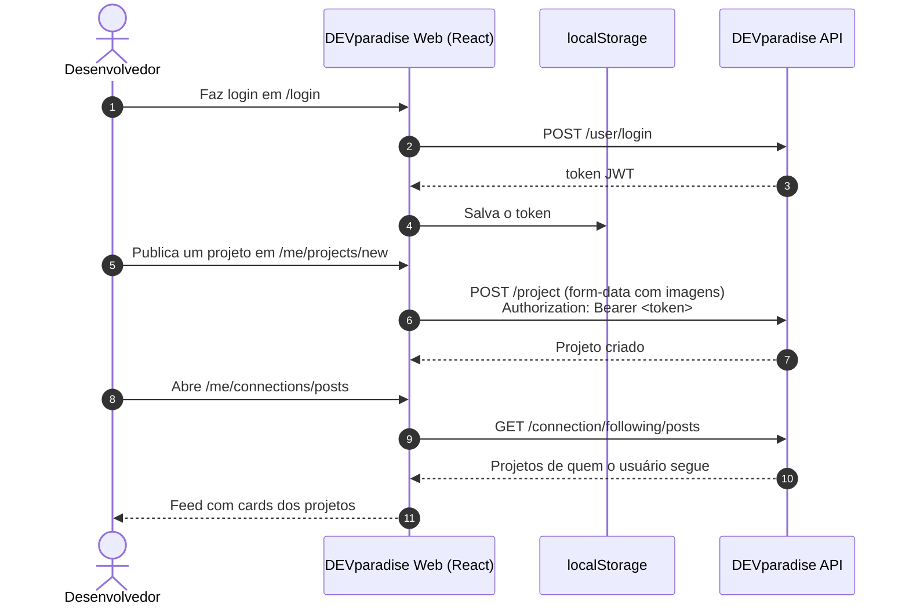
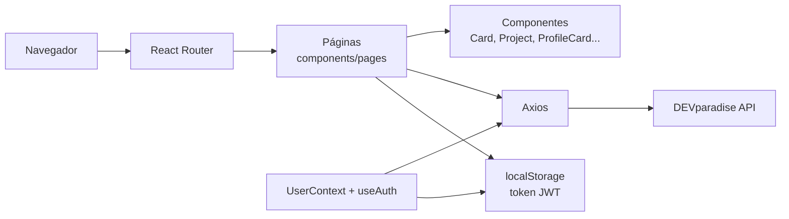

# 🌴 DEVparadise Web — Portfólio e Rede Social para Desenvolvedores


> Portfólio de projetos, busca de desenvolvedores e feed de quem você segue, numa única aplicação web.

O **DEVparadise Web** é a interface da plataforma desenvolvida como **TCC do curso técnico de Desenvolvimento de Sistemas da ETEC Professor Camargo Aranha**. É uma Single Page Application em **React 18** com **Vite**, que permite a desenvolvedores iniciantes publicar seus projetos, montar um perfil com as tecnologias que dominam e seguir outros desenvolvedores. Todos os dados vêm da [DEVparadise API](https://github.com/matheusnascimentods/devparadise-api).

🔗 **Deploy:** [devparadise-app.vercel.app](https://devparadise-app.vercel.app)



---

## ✨ O Problema
- **Portfólio disperso**: o desenvolvedor iniciante tem seus projetos espalhados entre repositórios e links soltos, sem uma vitrine única.
- **Pouca visibilidade**: sem uma comunidade, é difícil descobrir outros desenvolvedores e acompanhar o que eles publicam.

---

## 🚀 A Solução
- **Perfil do desenvolvedor**: nome, username, foto, descrição e habilidades (tags de tecnologias).
- **Gestão de projetos**: publicar, editar, excluir e favoritar projetos com título, descrição, tecnologias, imagens, repositório e página.
- **Busca**: pesquisa de projetos e usuários na mesma tela, com abas para filtrar.
- **Conexões**: seguir e deixar de seguir usuários, listas de seguidores e seguidos e um feed com os projetos de quem você segue.

---

## 🎯 Diferenciais
- **Galeria de imagens por projeto**: a página do projeto mostra as imagens enviadas num carrossel (rsuite).
- **Tags de tecnologias**: habilidades e tecnologias são informadas com um campo de tags (`TagInput` do rsuite).
- **Feedback imediato**: sucesso e erro das ações aparecem em toasts (react-toastify).
- **Layout responsivo**: header com navegação colapsável (react-bootstrap) e estilos de `responsive.css`.
- **Deploy como SPA na Vercel**: o `vercel.json` reescreve todas as rotas para `index.html`, permitindo abrir qualquer URL diretamente.

---

## 🛠️ Stack Tecnológica

| Camada | Tecnologia |
|---|---|
| **Framework** | React 18.3 |
| **Build & Dev Server** | Vite 5.4 (`@vitejs/plugin-react`) |
| **Roteamento** | React Router DOM 6.26 |
| **UI** | Bootstrap 5.3, React Bootstrap 2.10, rsuite 5.69, React Icons 5.3 |
| **Estilos** | CSS Modules por componente |
| **HTTP** | Axios 1.7 |
| **Notificações** | React Toastify 10 |
| **Lint** | ESLint 9 (react, react-hooks, react-refresh) |
| **Deploy** | Vercel |

---

## 🏛️ Arquitetura

Aplicação client-side sem camada de estado global além da autenticação: cada página busca os próprios dados na API com Axios.



- **`UserContext` / `useAuth`**: expõem `login`, `register`, `logout` e o estado `authenticated`; o token JWT fica em `localStorage`.
- **Páginas**: lêem o token do `localStorage`, enviam `Authorization: Bearer <token>` nas rotas protegidas da API e redirecionam para `/login` quando não há sessão.
- **Imagens**: fotos de perfil e de projetos são carregadas direto dos arquivos estáticos da API (`/public/images/users/...` e `/public/images/projects/...`).

---

## 🗺️ Telas & Rotas

| Rota | Tela | O que entrega | Acesso |
| :--- | :--- | :--- | :--- |
| `/` | Home | Listagem dos projetos publicados | Público |
| `/search` | Busca | Projetos e usuários encontrados, em abas | Público |
| `/login` | Login | Autenticação | Público |
| `/signup` | Cadastro | Nome, username, habilidades, e-mail, CPF, descrição e senha | Público |
| `/about` | Sobre | Apresentação do DEVparadise | Público |
| `/me` | Meu perfil | Dados, projetos e conexões do usuário logado | Logado |
| `/me/update` | Editar perfil | Dados do perfil e foto | Logado |
| `/me/changePassword` | Trocar senha | Senha atual, nova senha e confirmação | Logado |
| `/me/delete` | Excluir conta | Exclusão da conta mediante senha | Logado |
| `/me/projects` | Meus projetos | Busca, edição, exclusão e favoritos | Logado |
| `/me/projects/new` | Novo projeto | Publicação com imagens e tecnologias | Logado |
| `/me/projects/update/:id` | Editar projeto | Edição de um projeto próprio | Logado |
| `/me/connections/posts` | Feed | Projetos de quem você segue | Logado |
| `/projects/:id` | Projeto | Detalhe com carrossel de imagens | Público |
| `/user/:username` | Perfil de usuário | Perfil público com botão seguir / deixar de seguir | Público (seguir exige login) |
| `/user/:username/connections` | Conexões | Seguidores e seguidos, com busca | Público |
| `/user/:username/projects` | Projetos do usuário | Projetos do usuário, com busca | Público |
| `*` | Not Found | Página 404 | Público |

### Capturas de tela

<table>
  <tr>
    <td align="center" width="50%"><br/><sub>Home</sub></td>
    <td align="center" width="50%"><br/><sub>Sobre</sub></td>
  </tr>
  <tr>
    <td align="center" width="50%"><br/><sub>Login</sub></td>
    <td align="center" width="50%"><br/><sub>Cadastro</sub></td>
  </tr>
  <tr>
    <td align="center" width="50%"><br/><sub>Meu perfil</sub></td>
    <td align="center" width="50%"><br/><sub>Menu lateral</sub></td>
  </tr>
  <tr>
    <td align="center" width="50%"><br/><sub>Meus projetos</sub></td>
    <td align="center" width="50%"><br/><sub>Novo projeto</sub></td>
  </tr>
  <tr>
    <td align="center" width="50%"><br/><sub>Editar projeto</sub></td>
    <td align="center" width="50%"><br/><sub>Excluir projeto</sub></td>
  </tr>
  <tr>
    <td align="center" width="50%"><br/><sub>Projeto</sub></td>
    <td align="center" width="50%"><br/><sub>Feed de quem você segue</sub></td>
  </tr>
  <tr>
    <td align="center" width="50%"><br/><sub>Busca</sub></td>
    <td align="center" width="50%"><br/><sub>Busca: projetos</sub></td>
  </tr>
  <tr>
    <td align="center" width="50%"><br/><sub>Busca: usuários</sub></td>
    <td align="center" width="50%"><br/><sub>Perfil de usuário</sub></td>
  </tr>
  <tr>
    <td align="center" width="50%"><br/><sub>Seguidores</sub></td>
    <td align="center" width="50%"><br/><sub>Seguindo</sub></td>
  </tr>
  <tr>
    <td align="center" width="50%"><br/><sub>Trocar senha</sub></td>
    <td align="center" width="50%"><br/><sub>Excluir conta</sub></td>
  </tr>
</table>

---

## 📁 Estrutura do Projeto

```text
devparadise-web/
├── Screenshots/                 # Capturas das telas
├── public/                      # Assets estáticos (favicon)
├── src/
│   ├── assets/img/              # Logos e imagens padrão
│   ├── components/
│   │   ├── pages/               # Uma pasta por página (Home, Search, Auth, Me, MyProjects...)
│   │   ├── form/                # Input e TagInput
│   │   └── ...                  # Card, Header, Project, ProfileCard, Searchbar, Badges...
│   ├── context/UserContext.jsx  # Contexto de autenticação
│   ├── hooks/useAuth.js         # Login, cadastro e logout
│   ├── utils/                   # getCurrentUser e formatação de datas
│   ├── App.jsx                  # Definição das rotas
│   └── main.jsx                 # Ponto de entrada
├── index.html
├── vercel.json                  # Rewrite de SPA para a Vercel
└── vite.config.js
```

---

## ⚡ Quick Start

### Pré-requisitos
- [Node.js 20](https://nodejs.org/) ou superior
- [DEVparadise API](https://github.com/matheusnascimentods/devparadise-api) em execução (por padrão em `http://localhost:3000`)

### 1. Clonar o repositório
```bash
git clone https://github.com/matheusnascimentods/devparadise-web.git
cd devparadise-web
```

### 2. Subir a API
Siga o [Quick Start da API](https://github.com/matheusnascimentods/devparadise-api#-quick-start). A API só aceita requisições da origem definida em `FRONT_URL`, cujo padrão é `http://localhost:5173` (a porta do Vite).

### 3. Configurar o ambiente
Crie um arquivo `.env.local` na raiz do projeto:
```env
VITE_API_URL=http://localhost:3000
```

### 4. Executar o Frontend
```bash
npm install
npm run dev
```

A aplicação estará disponível em: **`http://localhost:5173`**

---

## 💻 Comandos Úteis

```bash
# Iniciar o servidor de desenvolvimento
npm run dev

# Gerar o build de produção (pasta dist/)
npm run build

# Servir o build localmente
npm run preview

# Rodar o lint
npm run lint
```

---

## 🔌 API Reference (Recursos Consumidos)

Todas as chamadas usam `VITE_API_URL` como base. Contratos completos no [README da API](https://github.com/matheusnascimentods/devparadise-api#-api-reference).

### 👤 Usuários
| Método | Rota | Uso na interface | Tela |
| :--- | :--- | :--- | :--- |
| `POST` | `/user/signup` | Cadastro e emissão do token | Cadastro |
| `POST` | `/user/login` | Login e emissão do token | Login |
| `GET` | `/user/me` | Dados do usuário logado | Meu perfil, Editar perfil, Editar projeto, Perfil de usuário |
| `GET` | `/user?q=` | Busca de usuários | Busca |
| `GET` | `/user?username=` | Perfil público | Perfil de usuário, Projetos do usuário |
| `GET` | `/user?id=` | Autor de um projeto | Componente `Project` (lista de projetos) |
| `PATCH` | `/user` | Edição do perfil e da foto (form-data) | Editar perfil |
| `PATCH` | `/user/change-password` | Troca de senha | Trocar senha |
| `DELETE` | `/user` | Exclusão da conta | Excluir conta |

### 🗂️ Projetos
| Método | Rota | Uso na interface | Tela |
| :--- | :--- | :--- | :--- |
| `GET` | `/project` | Todos os projetos | Home |
| `GET` | `/project?q=` | Busca de projetos | Busca |
| `GET` | `/project?id=` | Detalhe do projeto | Projeto |
| `GET` | `/project?author=` / `?q=&author=` | Projetos de um usuário, com busca | Perfil de usuário, Projetos do usuário |
| `GET` | `/project/me` / `?q=` / `?id=` | Projetos do usuário logado | Meu perfil, Meus projetos, Editar projeto |
| `POST` | `/project` | Publicação com imagens (form-data) | Novo projeto |
| `PATCH` | `/project/:id` | Edição (form-data) | Editar projeto |
| `PATCH` | `/project/favorite` | Favoritar / desfavoritar | Meus projetos |
| `DELETE` | `/project/:id` | Exclusão | Meus projetos |

### 🔗 Conexões
| Método | Rota | Uso na interface | Tela |
| :--- | :--- | :--- | :--- |
| `POST` | `/connection/follow` | Seguir usuário | Perfil de usuário |
| `DELETE` | `/connection/unfollow` | Deixar de seguir | Perfil de usuário |
| `GET` | `/connection/:username/status` | Se o usuário logado segue o perfil | Perfil de usuário |
| `GET` | `/connection/:username/followers` | Seguidores (aceita `?q=`) | Conexões |
| `GET` | `/connection/:username/following` | Seguidos (aceita `?q=`) | Conexões |
| `GET` | `/connection/following/posts` | Feed de projetos de quem você segue | Feed |

### 🖼️ Arquivos estáticos
| Método | Rota | Uso na interface |
| :--- | :--- | :--- |
| `GET` | `/public/images/users/<arquivo>` | Fotos de perfil |
| `GET` | `/public/images/projects/<arquivo>` | Imagens dos projetos |

---

## 🗂️ Variáveis de Ambiente & Configuração

| Variável | Descrição | Exemplo (Local) |
| :--- | :--- | :--- |
| `VITE_API_URL` | URL base da DEVparadise API, lida em build pelo Vite (`import.meta.env`) | `http://localhost:3000` |

Por ser prefixada com `VITE_`, a variável é embutida no bundle final; não coloque segredos nela.

---

## 🔒 Segurança & Boas Práticas

- **Token em `localStorage`**: o JWT fica no `localStorage` e é enviado como `Authorization: Bearer <token>`; por isso fica acessível a qualquer script da página (risco em caso de XSS).
- **Sem refresh token**: quando o JWT expira, é preciso entrar de novo.
- **Proteção de rotas no cliente**: cada página redireciona para `/login` quando não há token; a autorização efetiva é feita pela API. O componente `ProtectedRoute` existe, mas não é usado nas rotas.
- **`.env` fora do `.gitignore`**: o `.gitignore` ignora apenas `*.local`; use `.env.local` para não versionar configuração local.
- **Sem testes automatizados**: o projeto não possui suíte de testes nem pipeline de CI; a verificação disponível é o `npm run lint`.
- **Dependência sem uso**: `dotenv` está no `package.json`, mas o Vite já carrega os arquivos `.env` e o pacote não é importado no código.

---

## 🤝 Contribuindo

1. Faça um Fork do projeto
2. Crie uma branch para a sua funcionalidade (`git checkout -b feature/nome-da-feature`)
3. Rode `npm run lint` e `npm run build`
4. Faça o commit das suas alterações (`git commit -m 'feat: implementa nova funcionalidade'`)
5. Envie para o repositório remoto (`git push origin feature/nome-da-feature`)
6. Abra um **Pull Request** detalhando as alterações

---

## 📄 Licença

Distribuído sob a licença MIT. Veja [`LICENSE.txt`](LICENSE.txt) para mais detalhes.

---
Feito com ❤️ por [@matheusnascimentods](https://github.com/matheusnascimentods)
